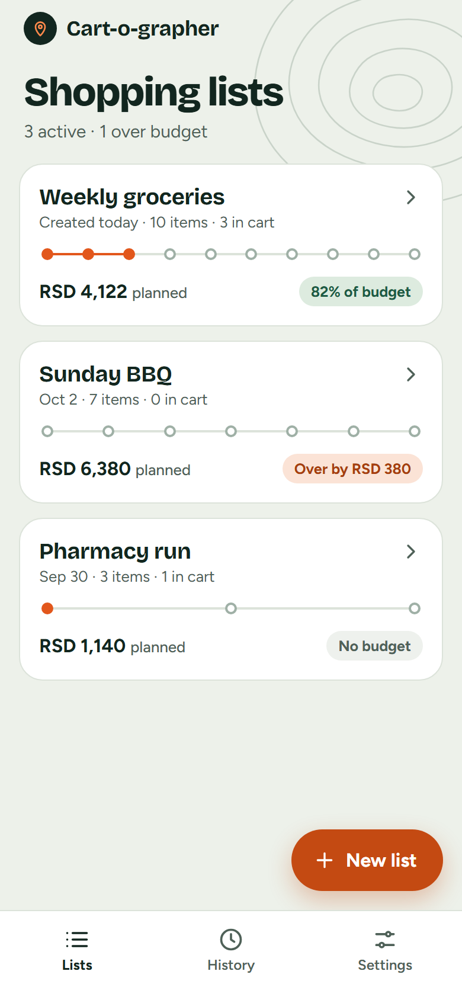
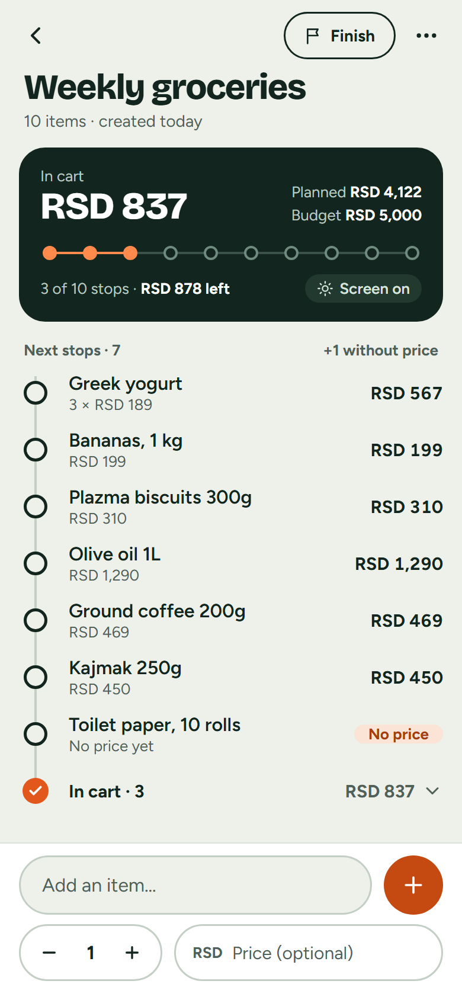
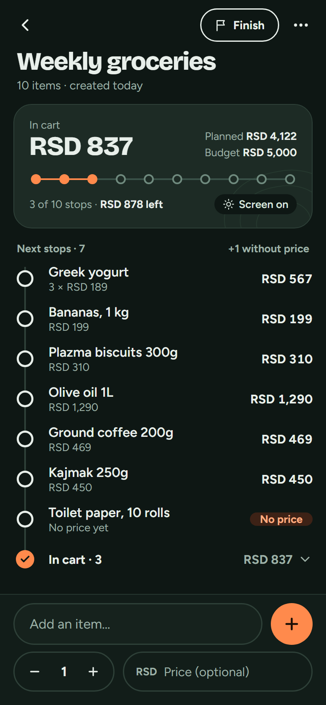
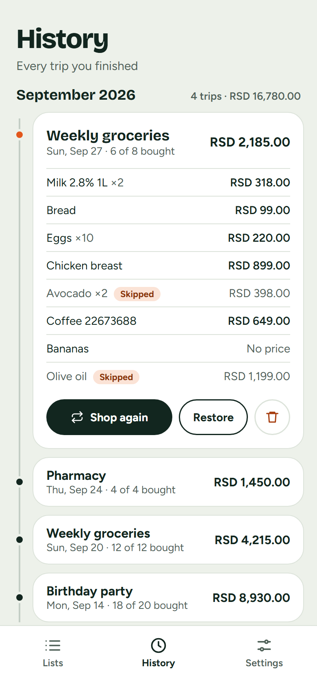

# Cart-o-grapher

A shopping list for your phone that treats a trip to the shop like a route:
every item is a stop, and you tick them off as you walk the aisles.

**Try it:** [cart-o-grapher.vladimir-milinic.com](https://cart-o-grapher.vladimir-milinic.com)
— it works offline and you can install it on your home screen.

<p>
  
  
  
  
</p>

<sub>Screens from the design mock-ups I made before building. The finished app
differs in a few small details.</sub>

## What it does

- Make lists with quantities and optional prices
- Tap an item to tick it, hold it to edit it
- Set a budget and see how close you are while you plan and shop
- Finish a trip: it moves to History, with the items you skipped marked
- Shop the same list again in one tap, or restore a finished trip
- Light and dark mode, and three currencies (RSD, EUR, USD)
- Keeps your screen on while a list is open
- Works offline, installs like an app, and tells you when a new version is ready
- Save all your lists to a backup file and load them back
- No account and no server: your lists stay on your device

## Why there is a version 2

Version 1 (tag [`v1.0`](https://github.com/vladamil/premium-shopping-list/tree/v1.0)) was my first React app. It worked,
but it had real problems: the phone's back button closed the app, the offline
cache never updated, and some rules (like the maximum name length) didn't agree
with each other.

For version 2 I started over with TypeScript, tests and a plan, and built it in
small pull requests. Lists saved by version 1 are moved over automatically the
first time version 2 opens.

## How it's built

- **React 19 + TypeScript** (strict mode), built with **Vite**
- **React Router** — every screen has its own URL, so back, refresh and links work
- **useReducer + Context** for the app's data (no extra state library)
- **Zod** checks data wherever it comes in: forms, saved data, backup files and
  old version 1 data
- **localStorage** for saving
- **CSS Modules** with colour variables, so dark mode is just a different set of colours
- **vite-plugin-pwa** for offline support and updates
- **Vitest** and **React Testing Library** for tests, run by GitHub Actions on
  every pull request

A few decisions I'm happy with:

- Money is stored in whole cents (`12050`, not `120.50`), so totals never get
  rounding errors.
- Totals are never saved, only calculated from the items, so they can't get out
  of sync.
- A new version never swaps itself in while you're shopping. The app asks first.

## Project structure

```
src/
  domain/      the rules and maths: lists, money, dates, history
  storage/     saving, loading, moving version 1 data, backup files
  state/       the actions and the reducer that change the app's data
  pages/       one component per screen
  components/  pieces the screens share
  hooks/       keeping the screen on
  theme/       light and dark mode
```

## Run it locally

You need Node.js 24.

```bash
npm install
npm run dev      # start the app at http://localhost:5173
npm test         # run the tests
npm run build    # make a production build in dist/
```
